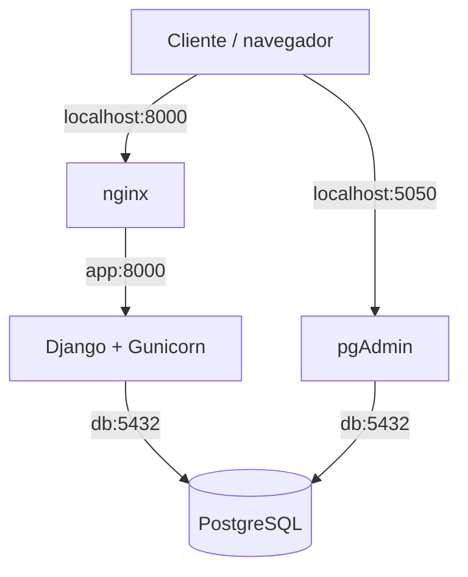

# AE4 — Aplicación web con base de datos en contenedores

## Objetivo del proyecto

El objetivo de esta práctica es desplegar una aplicación web contenerizada con Django y Gunicorn, PostgreSQL como base de datos, pgAdmin para administrar los datos y nginx como proxy inverso.

La infraestructura se definirá mediante Docker Compose. El despliegue se automatizará con un script `deploy.sh` y se comprobará mediante comandos estándar.

## Arquitectura

El proyecto estará formado por cuatro servicios:

- **nginx:** recibe las peticiones web a través del puerto 8000 del equipo anfitrión y las reenvía a Django.
- **app:** ejecuta Django mediante Gunicorn y proporciona las páginas HTML y los endpoints de la API.
- **db:** almacena los datos de los lugares en PostgreSQL.
- **pgadmin:** permite administrar PostgreSQL desde el navegador.

Los servicios se comunicarán mediante la red interna de Docker Compose.

### Diagrama de arquitectura



## Adaptación de Docker Compose

Se ha adaptado el archivo compose.yml para definir los cuatro servicios exigidos:

   - db: base de datos PostgreSQL.
   - pgadmin: interfaz web para administrar PostgreSQL.
   - app: aplicación Django ejecutada mediante Gunicorn.
   - nginx: servidor web y proxy inverso.

La configuración contempla variables de entorno para las credenciales, volúmenes para conservar los datos y comprobaciones de salud para coordinar el arranque de los servicios.

Los puertos publicados serán el 8000 para acceder a la aplicación web y el 5050 para acceder a pgAdmin. Los puertos internos de Django y PostgreSQL no se publicarán directamente en el anfitrión.

## Configuración nginx

Se ha creado el archivo nginx/default.conf a partir del material de referencia:

```text
server {
    listen 80;
    server_name _;

    location / {
        proxy_pass http://app:8000;
        proxy_set_header Host $host;
        proxy_set_header X-Real-IP $remote_addr;
        proxy_set_header X-Forwarded-For $proxy_add_x_forwarded_for;
    }
}
```

Nginx actúa como proxy inverso y constituye el punto de entrada al despliegue. Escucha en el puerto 80 del contenedor, publicado como puerto 8000 del anfitrión.

Las peticiones recibidas se reenvían al servicio app, que ejecuta Django mediante Gunicorn en el puerto interno 8000.

El archivo nginx/default.conf se monta en el contenedor mediante un bind mount de solo lectura. De esta forma, se utiliza la imagen oficial de Nginx sin necesidad de construir una imagen personalizada.

La aplicación puede probarse desde el anfitrión mediante http://localhost:8000/. El endpoint http://localhost:8000/healthz permite comprobar su disponibilidad.

El archivo nginx/default.conf se monta en el contenedor mediante un bind mount de solo lectura. De esta forma, se utiliza la imagen oficial de Nginx sin necesidad de construir una imagen personalizada.

La aplicación puede probarse desde el anfitrión mediante:

* Aplicación web: http://localhost:8000
* Comprobación de salud: http://localhost:8000/healthz

## Aplicación Django

La aplicación se encuentra en el directorio app/ y está organizada como un proyecto Django.

* app/manage.py: herramienta de administración de Django.
* app/config/: configuración del proyecto y punto de entrada **WSGI**.
* app/api/: rutas y vistas de la aplicación.
* app/Dockerfile: definición de la imagen del servidor de aplicaciones.
* app/requirements.txt: dependencias de Python.

Gunicorn ejecuta la aplicación mediante config.wsgi:application y escucha en el puerto **8000** del contenedor.

### Endpoints disponibles

| Endpoint | Función |
| --- | --- |
| / | Página **HTML** con el mensaje de la aplicación y el contador de visitas.|
| /healthz  | Comprueba que la aplicación responde.  |
| /api/mensaje | Devuelve un mensaje, nombre del contenedor y la fecha. |
| /api/visitas | Devuelve el contador de visitas. |
| /api/lugares | Consulta los lugares almacenados en PostgreSQL. |
| /api/login   | Permite la autenticación **LDAP** cuando se configura el servicio de directorio. |


## Base de datos PostgreSQL

PostgreSQL se ejecuta en el servicio db, utilizando la imagen postgres:16-alpine.

El archivo db/init.sql contiene la definición de la tabla places y los datos iniciales de ejemplo.

La inicialización se realiza automáticamente cuando PostgreSQL prepara un directorio de datos vacío. El script no se ejecuta de nuevo en cada arranque del contenedor.

La base de datos utiliza el volumen Docker db-data para conservar sus datos.

## Despliegue

El proyecto incluye un script deploy.sh que automatiza el despliegue y la comprobación de disponibilidad.

Para ejecutarlo:

```bash
./deploy.sh
```

El script realiza las siguientes operaciones:

1. Construye las imágenes necesarias.
2. Arranca los servicios mediante Docker Compose.
3. Espera a que el endpoint /healthz responda correctamente.
4. Si la aplicación no responde dentro del tiempo establecido, muestra el estado de los servicios y los últimos registros para facilitar el diagnóstico.

También se puede iniciar el despliegue manualmente:

```bash
docker compose build
docker compose up -d
```

## Comprobaciones

Estado de los contenedores

``` bash
docker compose ps
```

Comprobar la disponibilidad de la aplicación

```bash
curl -i http://localhost:8000/healthz
```


Consultar el mensaje de la aplicación

```bash
curl http://localhost:8000/api/mensaje
```

Consultar los lugares almacenados en PostgreSQL

```bash
curl http://localhost:8000/api/lugares
```

Consultar las tablas de PostgreSQL

```bash
docker compose exec db psql -U alumno -d travelroad -c "\dt"
```

Consultar los registros de la tabla places

```bash
docker compose exec db psql -U alumno -d travelroad -c "SELECT * FROM places;"
```
## Acceso a pgAdmin

pgAdmin está disponible en:

http://localhost:5050

Para registrar el servidor PostgreSQL, se utilizan los siguientes parámetros:

| Campo | Valor |
| --- | --- |
| Host |	db |
| Puerto | 5432 |
| Base de datos de mantenimiento | travelroad |
| Usuario | alumno |
| Contraseña | La configurada mediante DB_PASSWORD |

## Persistencia de datos

El despliegue utiliza los siguientes mecanismos de persistencia:

* db-data: conserva los datos de PostgreSQL.
* pgadmin-data: conserva la configuración de pgAdmin.
* ./data:/data: permite que la aplicación conserve el contador de visitas en el anfitrión, mediante el archivo data/visitas.txt.

Los volúmenes con nombre sobreviven a la eliminación de los contenedores mediante docker compose down.

Para detener los servicios:

```bash
docker compose down
```

Para eliminar también los volúmenes y los datos almacenados en ellos:

```bash
docker compose down -v
```
