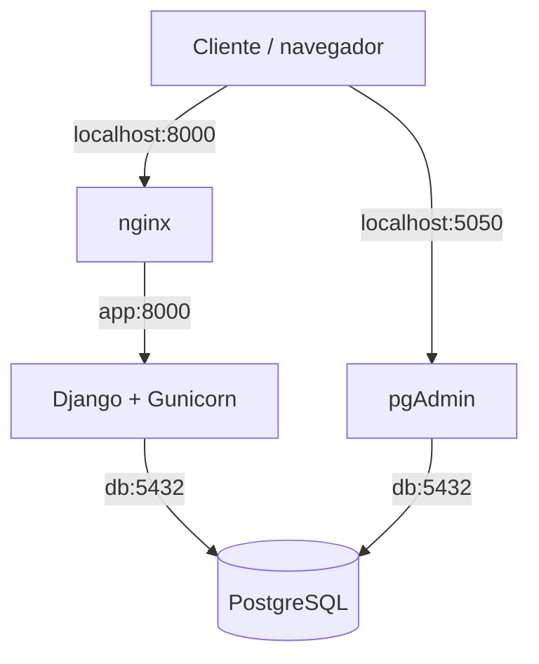

# AE4 — Aplicación web con base de datos en contenedores

## 1. Objetivo del proyecto

El objetivo de esta práctica es desplegar una aplicación web contenerizada con Django y Gunicorn, PostgreSQL como base de datos, pgAdmin para administrar los datos y nginx como proxy inverso.

La infraestructura se definirá mediante Docker Compose. El despliegue se automatizará con un script `deploy.sh` y se comprobará mediante comandos estándar.

## 2. Arquitectura

El proyecto estará formado por cuatro servicios:

- **nginx:** recibe las peticiones web a través del puerto 8000 del equipo anfitrión y las reenvía a Django.
- **app:** ejecuta Django mediante Gunicorn y proporciona las páginas HTML y los endpoints de la API.
- **db:** almacena los datos de los lugares en PostgreSQL.
- **pgadmin:** permite administrar PostgreSQL desde el navegador.

Los servicios se comunicarán mediante la red interna de Docker Compose.

### Diagrama de arquitectura

## Adaptación de Docker Compose

Se ha adaptado el archivo compose.yml para definir los cuatro servicios exigidos:

   - db: base de datos PostgreSQL.
   - pgadmin: interfaz web para administrar PostgreSQL.
   - app: aplicación Django ejecutada mediante Gunicorn.
   - nginx: servidor web y proxy inverso.

La configuración contempla variables de entorno para las credenciales, volúmenes para conservar los datos y comprobaciones de salud para coordinar el arranque de los servicios.

Los puertos publicados serán el 8000 para acceder a la aplicación web y el 5050 para acceder a pgAdmin. Los puertos internos de Django y PostgreSQL no se publicarán directamente en el anfitrión.
